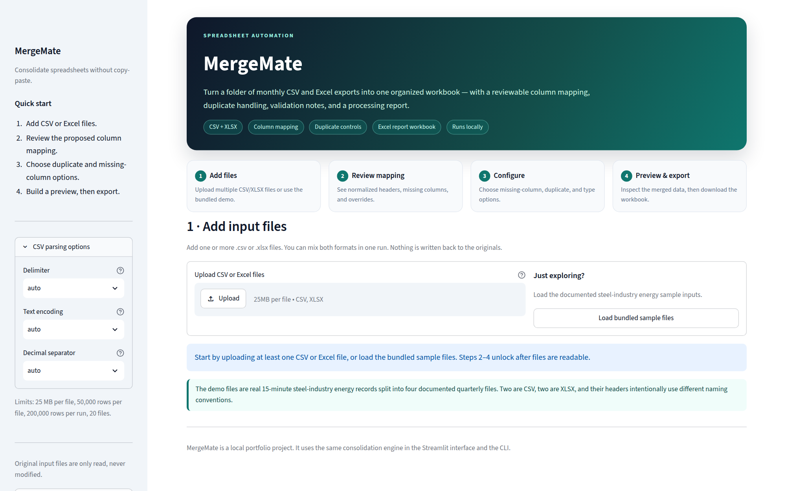
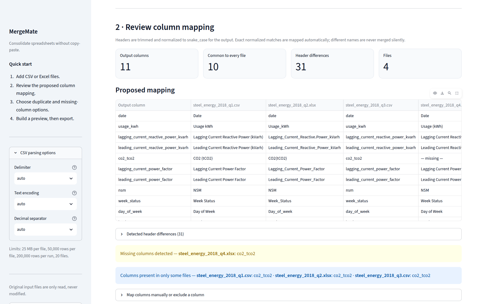
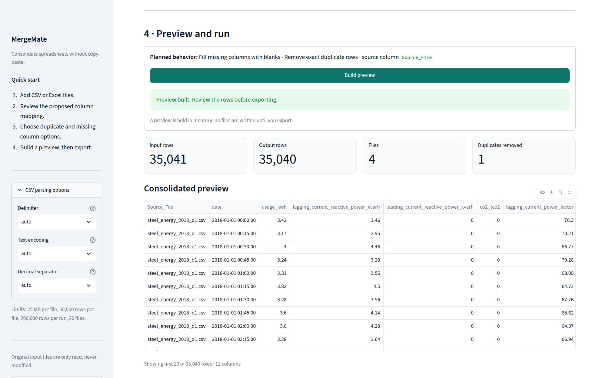
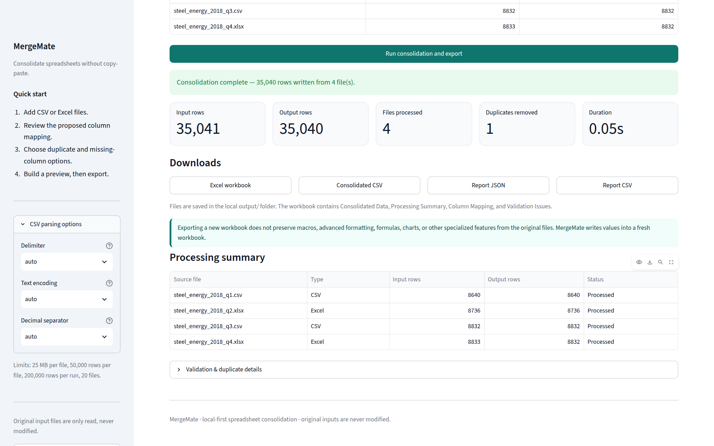
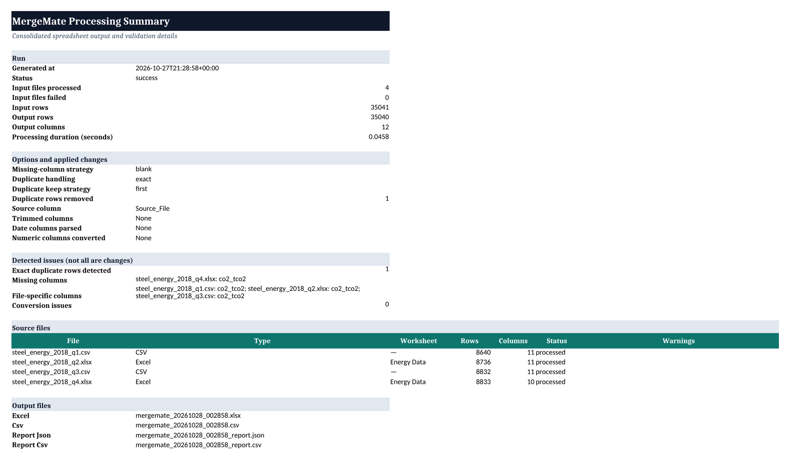

# MergeMate

**Consolidate a folder of CSV and Excel exports into one clean, documented
workbook.**

MergeMate is a local-first spreadsheet consolidation tool with two interfaces:
a Streamlit app for interactive review and a Python CLI for repeatable runs.
It reads multiple `.csv` and `.xlsx` files, normalizes their headers, proposes
an explicit column mapping, handles missing columns and duplicates, and writes
a formatted Excel workbook plus CSV and processing reports.

The app and the CLI use the same consolidation engine. The UI does not
reimplement any processing rules.



## Why this exists

Monthly exports rarely arrive in the same shape. One file uses `Usage kWh`,
another uses `Usage_kWh`, a third uses `usage_kwh`, and one may be missing a
column entirely. Copy-pasting them into a master sheet is slow, easy to get
wrong, and hard to audit later.

MergeMate makes those decisions visible before the output is written:

- Which source header maps to which output column?
- Which columns are missing from which files?
- Which rows are duplicates, and what was removed?
- Which values failed an optional date or number conversion?
- What exactly did the run do?

The result is a workbook that a reviewer can inspect, not just a merged file.

## What it does

- Reads **multiple CSV and XLSX files** in one run, including mixed formats.
- Detects CSV **delimiter, encoding, and decimal separator** automatically, with
  explicit overrides when needed.
- Selects a worksheet from multi-sheet workbooks (first sheet by default).
- **Normalizes headers** to snake_case and builds a reviewable mapping plan.
- Never merges genuinely different header names silently. Exact normalized
  matches are automatic; close matches are suggestions only; explicit overrides
  are available in the app and through a JSON mapping file in the CLI.
- Detects **missing columns** and **file-specific columns** per input file.
- Handles missing columns with three policies: fill with blanks, exclude the
  column, or reject incompatible files.
- Handles duplicates with three policies: keep all, remove exact duplicates, or
  remove duplicates by selected key columns (keeping first or last).
- Optionally trims text, parses dates, and converts numbers. Invalid conversions
  become blank and are reported; rows are never deleted automatically.
- Adds a `Source_File` column so every output row is traceable.
- Exports:
  - a formatted **Excel workbook** with `Consolidated Data`, `Processing Summary`,
    `Column Mapping`, and `Validation Issues` sheets;
  - a UTF-8 CSV of the consolidated data;
  - a structured JSON report and a flattened CSV report.
- Enforces local limits and reports unreadable files instead of silently skipping
  them.
- Never writes back to the original input files.

## Screenshots

| Review the mapping | Inspect the preview |
| --- | --- |
|  |  |

| Export and download | Workbook summary |
| --- | --- |
|  |  |

The CLI, test, workbook, and remaining captures are in
[`docs/screenshots/`](docs/screenshots/), with capture details in
[`docs/screenshots/README.md`](docs/screenshots/README.md).

## Demo dataset

The bundled demo uses the real **Steel Industry Energy Consumption** dataset
from the UCI Machine Learning Repository:

> V E, S., Shin, C., & Cho, Y. (2021). Steel Industry Energy Consumption
> [Dataset]. UCI Machine Learning Repository.
> [https://doi.org/10.24432/C52G8C](https://doi.org/10.24432/C52G8C)

- **License:** [CC BY 4.0](https://creativecommons.org/licenses/by/4.0/)
- **Source records:** 35,040 fifteen-minute measurements from 2018
- **Source columns:** 11
- **Local source file:** `data/source/Steel_industry_data.csv`
- **Source SHA-256:** `9b1cee6f9cb9cd9df2b95814ca90a9a2ff15b7f5f1fba0fae3c643e82072eacc`

The source is split deterministically into four quarterly demonstration files:
two CSV and two XLSX. The headers intentionally vary, Q4 intentionally omits
`CO2 (tCO2)`, and Q4 contains one exact duplicate record. Data values are
otherwise unchanged apart from a consistent date-string format across CSV and
XLSX. Full attribution, checksums, and the exact modification list are in
[`data/README.md`](data/README.md).

### Demo results

With the default **fill missing columns with blanks** policy and **remove exact
duplicate rows**:

| Metric | Value |
| --- | ---: |
| Input files | 4 (2 CSV, 2 XLSX) |
| Input rows | 35,041 |
| Output rows | 35,040 |
| Duplicate rows removed | 1 |
| Output columns | 12 (11 data columns + `Source_File`) |
| Header differences normalized | 31 |
| Missing column filled | `co2_tco2` in the Q4 file |

The consolidation step takes roughly 0.05–0.06 seconds for this demo in the
captured environment. A full CLI run takes longer because writing the formatted
35,040-row workbook dominates the run (about 9 seconds here).

## Quick start

Requires **Python 3.11+**.

```bash
cd mergemate
python3 -m venv .venv
source .venv/bin/activate        # Windows: .venv\Scripts\activate
pip install -e ".[dev]"
```

### Run the Streamlit app

```bash
streamlit run app.py
```

Open the local URL Streamlit prints, then either upload your own files or click
**Load bundled sample files**. The sample button reads `data/sample_inputs/`
without modifying it.

### Run the CLI

```bash
mergemate merge data/sample_inputs --output output \
  --duplicates exact --parse-date date --report-format both
```

The same command through the module entry point:

```bash
python -m mergemate.cli merge data/sample_inputs --output output \
  --duplicates exact --parse-date date --report-format both
```

The run writes four files to `output/`:

```text
mergemate_YYYYMMDD_HHMMSS.xlsx
mergemate_YYYYMMDD_HHMMSS.csv
mergemate_YYYYMMDD_HHMMSS_report.json
mergemate_YYYYMMDD_HHMMSS_report.csv
```

## CLI reference

```text
mergemate merge INPUT [INPUT ...] [options]
```

`INPUT` can be one or more `.csv`/`.xlsx` files or directories. Directories are
scanned non-recursively unless `--recursive` is used. The output directory is
excluded from directory scans.

| Option | Description |
| --- | --- |
| `-o, --output DIR` | Output directory (default: `output`). |
| `--sheet FILE=SHEET` | Worksheet to read from an XLSX file. Repeatable. First sheet is used when omitted. |
| `--mapping PATH` | JSON file with explicit source-to-output column mappings. |
| `--missing-columns {blank,exclude,reject}` | Missing-column policy (default: `blank`). |
| `--duplicates {keep-all,exact,keys}` | Duplicate policy (default: `keep-all`). |
| `--key-columns COLS` | Comma-separated output columns for `--duplicates keys`. |
| `--keep {first,last}` | Which duplicate to keep for key-based removal (default: `first`). |
| `--source-column NAME` | Name of the source-file column (default: `Source_File`). |
| `--trim COLS` | Comma-separated text columns to trim. |
| `--parse-date COLS` | Comma-separated columns to parse as dates. |
| `--numeric COLS` | Comma-separated columns to convert to numbers. |
| `--delimiter {auto,comma,semicolon,tab,pipe}` | CSV delimiter (default: `auto`). |
| `--encoding {auto,utf-8,utf-8-sig,latin-1}` | CSV encoding (default: `auto`). |
| `--decimal {auto,dot,comma}` | CSV decimal separator (default: `auto`). |
| `--report-format {json,csv,both}` | Processing report format (default: `json`). |
| `--skip-invalid` | Continue with readable files; skipped files are recorded in the report. |
| `--recursive` | Search input directories recursively. |
| `--max-rows N` | Maximum rows per input file (default: 50,000). |
| `--max-files N` | Maximum number of input files (default: 20). |
| `--quiet` | Only print final output locations and errors. |

Run `mergemate merge --help` for the full argparse help.

### Examples

**Use a JSON mapping when headers are genuinely different.** The included
example renames the usage column to `energy_kwh` in all four demo files:

```bash
mergemate merge data/sample_inputs --output output \
  --mapping examples/mapping.json --duplicates exact
```

`examples/mapping.json`:

```json
{
  "files": {
    "steel_energy_2018_q1.csv": {"Usage kWh": "energy_kwh"},
    "steel_energy_2018_q2.xlsx": {"Usage_kWh": "energy_kwh"},
    "steel_energy_2018_q3.csv": {"usage_kwh": "energy_kwh"},
    "steel_energy_2018_q4.xlsx": {"Usage (kWh)": "energy_kwh"}
  }
}
```

A mapping value of `null` (or an empty string) ignores that source column. You
can also use the separate `ignore` object:

```json
{
  "files": {},
  "ignore": {
    "steel_energy_2018_q1.csv": ["NSM"]
  }
}
```

**Reject incompatible files.** This exits with code 1 because Q4 is missing
`co2_tco2`:

```bash
mergemate merge data/sample_inputs --output output --missing-columns reject
```

**Drop columns that are not present in every file:**

```bash
mergemate merge data/sample_inputs --output output --missing-columns exclude
```

**Select a worksheet explicitly:**

```bash
mergemate merge data/sample_inputs --output output \
  --sheet "steel_energy_2018_q2.xlsx=Energy Data"
```

**Continue past a corrupt workbook.** A partial result is written and the exit
code is 3. Here `broken.xlsx` is a file that exists but is not a valid workbook:

```bash
printf 'not a workbook' > broken.xlsx
mergemate merge data/sample_inputs broken.xlsx --output output --skip-invalid
rm broken.xlsx
```

### Exit codes

| Code | Meaning |
| ---: | --- |
| `0` | Success. |
| `1` | Input, mapping, consolidation, or export error. No complete output was written. |
| `2` | Invalid command-line usage (argparse). |
| `3` | Partial success: readable files were processed and skipped files are recorded in the report. |
| `130` | Cancelled with Ctrl+C. |

## Output workbook

Every export creates a fresh workbook with four sheets:

| Sheet | Contents |
| --- | --- |
| `Consolidated Data` | The merged rows, with `Source_File` first. Styled header, frozen top row, autofilter, and sized columns. |
| `Processing Summary` | Run status, input/output counts, options actually applied, detected issues, source-file table, and output file names. |
| `Column Mapping` | One row per source header: file, source header, output column, status (`mapped`/`ignored`), and note. |
| `Validation Issues` | Severity, code, file, and message for each warning or error. |

The CSV is UTF-8 with a BOM for Excel compatibility. The JSON report is the
canonical audit artifact; the CSV report is a flattened two-column view for quick
inspection.

The report keeps **detected** facts separate from **applied** changes. For
example, exact duplicates can be detected and counted even when the policy is
`keep-all` and no rows are removed. See the `detected` and `applied` sections of
the JSON report.

## Processing rules

### Header normalization

Headers are trimmed, non-word characters become underscores, repeated
underscores collapse, and the result is lowercased. For example:

```text
Usage kWh                                  -> usage_kwh
Usage_kWh                                  -> usage_kwh
Lagging_Current_Reactive.Power_kVarh       -> lagging_current_reactive_power_kvarh
CO2(tCO2)                                  -> co2_tco2
Week Status                                -> week_status
```

Normalization only changes headers, never data values. Two headers in the same
file that normalize to the same name are rejected as ambiguous.

### Mapping

- Exact normalized matches map automatically.
- Different names are **not** merged automatically.
- Similar names are surfaced as suggestions in the report, but suggestions are
  never applied without an explicit mapping.
- A source column can be mapped to a custom output name, or ignored.
- Two source columns in one file cannot map to the same output column.

### Missing columns

| Policy | Behavior |
| --- | --- |
| `blank` (default) | Keep the union of columns. Files without a column get a blank value there. |
| `exclude` | Keep only columns present in every readable file. Excluded columns are listed in the report. |
| `reject` | Stop with an error if any file is missing a column. |

### Duplicates

| Policy | Behavior |
| --- | --- |
| `keep-all` (default) | Remove nothing. Exact duplicates are still counted in the report. |
| `exact` | Remove rows that match on every output data column except `Source_File`; keep the first occurrence. |
| `keys` | Remove rows that match on the selected key columns; keep the first or last occurrence. |

### Optional normalization

- **Trim:** removes leading/trailing whitespace from text columns.
- **Parse dates:** uses pandas mixed-format parsing; invalid values become blank
  and are reported.
- **Convert numeric:** invalid values become blank and are reported.

Rows are never deleted by a failed conversion. A column cannot be parsed as both
a date and a number, and trimming is only allowed on text columns.

## Architecture

```text
app.py                         Streamlit UI and session state
mergemate/
  cli.py                       argparse CLI, input discovery, exit codes
  file_readers.py              CSV/XLSX readers, auto-detection, limits
  column_mapping.py            normalization, mapping plan, compatibility checks
  consolidation.py             shared engine: mapping, missing columns, conversions, duplicates
  reporting.py                 JSON/CSV processing reports
  export.py                    formatted workbook, CSV, report files
  validation.py                validation issue model
  config.py                    constants and limits
  exceptions.py                domain errors
scripts/prepare_sample_data.py Deterministic demo generation
tests/                         68 pytest tests
data/                          Source dataset and documented demo inputs
docs/screenshots/              Genuine app, workbook, CLI, and test captures
examples/mapping.json          Explicit mapping example
portfolio/                     Case study, proposal, and demo script
```

The Streamlit app calls `file_readers`, `column_mapping`, `consolidation`,
`reporting`, and `export` directly. The CLI calls the same modules. Neither
interface contains a second implementation of the merge rules.

## Tests and verification

```bash
pytest -q
ruff check .
```

Current results in this repository:

- **68 tests passed**
- **Ruff: all checks passed**

The suite covers:

| Area | Tests | Examples |
| --- | ---: | --- |
| File readers | 18 | Semicolon/comma-decimal CSVs, worksheet selection, malformed/empty files, size/row/column limits, delimiter/decimal conflicts |
| Column mapping | 13 | Normalization variants, explicit overrides, ignored columns, duplicate normalized headers, suggestions not auto-applied, deterministic column order |
| Consolidation | 16 | All missing-column strategies, duplicate modes, key keep-first/keep-last, conversions, invalid options, source-column collision, determinism |
| Export and reporting | 10 | Workbook sheets/formatting, date formats, report accuracy, partial status, no row contents in reports, CSV read-back, original-input immutability |
| CLI | 11 | Help, end-to-end run, unsupported/no files, strict vs. `--skip-invalid`, worksheet selection, mapping JSON, reject policy, recursive scan, invalid sheet syntax |

The tests verify that original input files are unchanged by comparing content
hashes before and after a run, and that repeated processing is deterministic.

## Limits and non-goals

MergeMate is intentionally a local, everyday spreadsheet tool, not a data
platform.

- **Formats:** `.csv` and `.xlsx` only. Legacy `.xls`, `.xlsm`, `.xlsb`, and
  other formats are not supported.
- **Limits:** 25 MB per file, 50,000 rows per file, 200,000 rows per run,
  200 columns, 20 files.
- **Memory:** files are processed in memory; there is no database, cloud
  service, API, queue, or orchestration layer.
- **Workbook output:** values are written into a fresh workbook. Macros,
  formulas, charts, pivot tables, merged cells, conditional formatting, and
  other specialized features from the inputs are not preserved.
- **Excel worksheets:** the first worksheet is used by default. Multi-sheet
  workbooks can be handled with an explicit selection, one worksheet per file.
- **Fuzzy matching:** close header names are suggestions only. MergeMate does not
  silently fuzzy-merge columns.
- **Authentication:** none. The Streamlit app is intended for local use.

## Project structure

```text
mergemate/
├── app.py
├── mergemate/
│   ├── __init__.py
│   ├── cli.py
│   ├── column_mapping.py
│   ├── config.py
│   ├── consolidation.py
│   ├── exceptions.py
│   ├── export.py
│   ├── file_readers.py
│   ├── reporting.py
│   └── validation.py
├── data/
│   ├── README.md
│   ├── source/Steel_industry_data.csv
│   └── sample_inputs/           # 4 demo files + manifest.json
├── docs/screenshots/            # 11 captures + capture notes
├── examples/mapping.json
├── portfolio/
├── scripts/prepare_sample_data.py
├── tests/
├── .streamlit/config.toml
├── LICENSE
├── README.md
└── pyproject.toml
```

## Data license and citation

The **source code** is licensed under the MIT License; see [`LICENSE`](LICENSE).

The **dataset and derived demo files** are licensed under **CC BY 4.0**, not
MIT. If you reuse them, keep the attribution and indicate the changes:

> V E, S., Shin, C., & Cho, Y. (2021). Steel Industry Energy Consumption
> [Dataset]. UCI Machine Learning Repository.
> [https://doi.org/10.24432/C52G8C](https://doi.org/10.24432/C52G8C)

See [`data/README.md`](data/README.md) for the source link, checksums, split
procedure, header variations, missing column, duplicate record, and the exact
list of changes.

## Portfolio package

The [`portfolio/`](portfolio/) folder contains a case study, an Upwork-style
proposal template, a five-minute demo script, and a LinkedIn post draft. They
are written against the verified behavior and screenshots in this repository.
